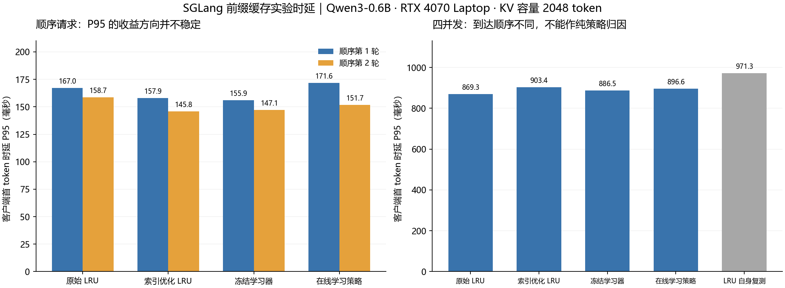

# SGLang 前缀缓存策略中文版时延报告

实验日期：2026 年 11 月 24 日。设备：RTX 4070 Laptop 8GB。模型：Qwen3-0.6B。

## 一、结论

**当前原型已能在本机完成真实 GPU 推理，但尚未证明“数据结构优化＋价值指标＋在线学习”带来稳定的时延收益。**

- 两轮顺序请求中，四种策略的复用 token 数均为 **37,120**，生成文本一致。学习策略相对 LRU 的 P95 时延第一轮上升 **2.77%**，第二轮下降 **4.42%**，收益方向不稳定。
- 四并发首轮中，学习策略的复用量比 LRU 高 **12.91%**，但 P95 时延仍高 **3.14%**。各组实际到达顺序不同，不能将复用增量全部归因于学习器。
- 索引优化 LRU 的淘汰管理开销在两轮中均略低于原始 LRU，但绝对差异很小，无法解释全部端到端时延差异。
- 本报告共包含 **3,600 个成功的正式请求**：普通配置 3,120 个，确定性对照 480 个。确定性模式下，LRU 与在线学习策略各完成 240 个请求，逐请求生成文本全部一致。

## 二、实验配置与测量口径

| 项目 | 配置 |
| --- | --- |
| GPU | NVIDIA RTX 4070 Laptop，实测总显存 8188 MiB |
| 推理模型 | Qwen3-0.6B，BF16 权重与 KV |
| 框架 | SGLang v0.5.6.post2 的独立研究分支 |
| 运行环境 | Linux GPU 容器，PyTorch 2.9.1＋CUDA 13.0，Transformers 4.57.1 |
| 实际 KV 容量 | 2048 token，启动及服务状态均核对 |
| 上下文上限 | 2048 token |
| 普通配置 | Triton 注意力，关闭 CUDA Graph，prefill 分块 512 token，最大运行请求数 4 |
| 输入 | 自有合成 token trace；12 个前缀组；每 5 个请求含 1 个一次性前缀；中途热点切换 |
| 输入长度 | 主要为 272、528、784 token；同一 seed 保证相同输入序列 |
| 输出 | 每请求固定生成 16 token，temperature=0，忽略 EOS 提前停止 |
| 每组流程 | 24 请求预热 → 清空缓存及学习状态 → 正式回放 240 请求 |
| 顺序模式 | 一次发送一个请求；四种策略各运行两轮，第二轮反向执行策略顺序 |
| 四并发模式 | 每批最多 4 个请求，等待整批完成后提交下一批；并非持续开放到达压力 |

**TTFT** 是客户端从发送请求到收到首个含生成 token 的流式事件的时间，包含客户端、传输、调度与模型执行影响。P50 为中位数，P95/P99 用于观察较慢请求，均按每轮 240 个样本单独计算，没有将两轮合并成更有利的数字。

**端到端时延** 是从发送到完整流式响应结束的时间。**服务端排队时间** 使用响应中 `queue_time` 字段；它与客户端 TTFT 的测量边界不同。**管理开销** 是代码内的观测与淘汰路径累计计时，不是 GPU kernel 时间，也不是完整调度器开销。

四种策略分别为：原始 LRU；仅维护可淘汰叶节点索引的 `indexed_lru`；带价值评分但权重冻结的 `reuse_value_frozen`；启用在线更新的 `reuse_value`。共享前缀树与 KV 复用来自 SGLang 原有机制，本项目修改的是管理结构和保留决策。

## 三、顺序请求时延

### 第 1 轮

| 策略 | TTFT P50／ms | TTFT P95／ms | TTFT P99／ms | 复用 token 数 |
| --- | --- | --- | --- | --- |
| 原始 LRU | 120.15 | 167.01 | 185.18 | 37,120 |
| 索引优化 LRU | 110.39 | 157.88 | 178.81 | 37,120 |
| 冻结学习器 | 110.71 | 155.90 | 171.59 | 37,120 |
| 在线学习策略 | 117.76 | 171.63 | 201.21 | 37,120 |

### 第 2 轮

| 策略 | TTFT P50／ms | TTFT P95／ms | TTFT P99／ms | 复用 token 数 |
| --- | --- | --- | --- | --- |
| 原始 LRU | 110.52 | 158.72 | 172.38 | 37,120 |
| 索引优化 LRU | 103.68 | 145.81 | 174.56 | 37,120 |
| 冻结学习器 | 110.12 | 147.09 | 165.20 | 37,120 |
| 在线学习策略 | 108.06 | 151.71 | 167.66 | 37,120 |

两轮中所有策略均完成 240/240 个请求，逐请求缓存命中 token 数与同轮 LRU 一致，生成文本也一致。因此，目前没有观察到学习器通过减少重复计算来改善这一顺序负载。

学习器确实运行：每轮记录 240 个逻辑请求观测、1,212 个正样本和 328 个负样本，在线权重发生变化；冻结组权重保持为零。**“学习器完成更新”与“服务时延得到改善”是两项不同结论。** 两轮数据不足以建立统计显著性，执行顺序、运行时抖动和笔记本状态的影响尚未被完全分离。

## 四、四并发时延与排队

| 策略 | TTFT P50／ms | TTFT P95／ms | TTFT P99／ms | 端到端 P95／ms | 复用 token 数 |
| --- | --- | --- | --- | --- | --- |
| 原始 LRU | 159.42 | 869.32 | 937.19 | 1397.83 | 34,208 |
| 索引优化 LRU | 163.72 | 903.36 | 951.55 | 1448.05 | 32,624 |
| 冻结学习器 | 158.21 | 886.51 | 946.02 | 1416.12 | 32,144 |
| 在线学习策略 | 158.91 | 896.64 | 934.22 | 1426.32 | 38,624 |

学习策略复用量增加并未转化成 P95 改善。由于实际到达顺序、批次组成和运行时路径也发生变化，这组结果只能描述本轮观测，不能作为纯缓存策略的因果比较。

| 策略 | 最大服务端排队／ms | 最大 TTFT／ms | 最大端到端时延／ms |
| --- | --- | --- | --- |
| 原始 LRU | 884.22 | 1076.36 | 1708.26 |
| 索引优化 LRU | 837.06 | 1003.80 | 1609.27 |
| 冻结学习器 | 829.60 | 981.22 | 1533.18 |
| 在线学习策略 | 780.27 | 968.22 | 1521.25 |

各前缀组均完成请求，响应中未报告重调度回退（`total_retractions` 累计为 0）。但仍存在组间尾延迟回退，例如：

| 前缀组 | 请求数 | LRU P95／ms | 学习策略 P95／ms |
| --- | --- | --- | --- |
| one_off | 48 | 236.13 | 868.77 |
| 6 | 43 | 230.16 | 823.74 |
| 8 | 10 | 234.44 | 585.81 |

这些是保留的负面观测，**不能在到达顺序不同的条件下直接认定由学习策略造成**。每组样本量有限，少数组只有 4 个请求，尾部分位数尤其不稳定。本轮没有持续到达、外部业务 SLO 或无限时间跨度条件，因此不能宣称已证明公平性或无饥饿。

### 并发输出差异与基线自身复测

相对四并发 LRU，索引组、冻结组、学习组分别有 **23、19、27** 个请求的生成文本不同；60 批请求中，服务端到达顺序分别有 **47、39、50** 批不同。

另一次 LRU 自身复测中，也出现 **21/240** 个文本差异和 **50/60** 批到达顺序变化。其复用量从 34,208 变为 32,112，P95 从 869.32 ms 变为 971.31 ms。客户端最大 TTFT 达到 5392.50 ms，而最大服务端排队时间为 895.71 ms；异常被保留，尚未确认具体原因。

这说明普通模式的并发基线本身存在变动，单凭基线自身复测不能解释所有输出差异。另行完成的确定性对照中，LRU 与在线学习策略的 240 个请求生成文本全部一致，详见第六节；该结论仅覆盖本次配置与输入，不能扩展为所有并发场景的正确性保证。

## 五、缓存管理开销

以下均为每轮 240 请求的累计计时；“按请求摊销”是累计观测加淘汰时间除以 240，不是每次请求都实际花费该时间。

| 策略 | 第 1 轮观测累计／ms | 第 1 轮淘汰累计／ms | 第 1 轮合计／ms | 按请求摊销／ms | 第 2 轮合计／ms |
| --- | --- | --- | --- | --- | --- |
| 原始 LRU | 0.00 | 37.94 | 37.94 | 0.16 | 39.82 |
| 索引优化 LRU | 0.00 | 34.46 | 34.46 | 0.14 | 35.68 |
| 冻结学习器 | 61.61 | 99.37 | 160.98 | 0.67 | 155.83 |
| 在线学习策略 | 64.72 | 106.85 | 171.57 | 0.71 | 163.19 |

索引优化 LRU 第一轮仅减少约 3.47 ms、第二轮减少约 4.14 ms 的累计淘汰耗时。相较之下，在线学习需要额外维护前缀统计并评分：第一轮观测加淘汰累计约 171.57 ms，原始 LRU 为 37.94 ms。对当前小模型与小缓存而言，这些额外开销必须由实际减少的 prefill 或更好的排队结果补偿；目前尚无稳定收益证据。

当前价值指标使用复用概率、时间衰减和前缀深度形成成本代理，并未使用实测 GPU prefill 时间，因此不能把分数提升、复用 token 增加直接换算成 GPU 成本节省。

## 六、确定性输出对照

确定性模式使用 PyTorch 采样及 Triton 的批次不变执行路径，与普通配置分开统计。该固定版本默认要求 4096-token 的 prefill 截断对齐；原 512-token 预算使长请求无法进入执行。两次失败预热及调用栈已保留，启动脚本已将**确定性诊断**的分块预算修正为 4096。

修正后，确定性 LRU 完成 240/240 个请求。学习组第一次在模型初始化阶段报显存不足；停止已有研究 GPU 容器后，在**不调整实验参数**的条件下重试成功，并完成 240/240 个请求。失败启动日志仍保留，不能据此认定学习机制导致额外显存占用。

| 策略 | 请求完成 | TTFT P50／ms | TTFT P95／ms | TTFT P99／ms | 端到端 P95／ms | 复用 token 数 |
| --- | --- | --- | --- | --- | --- | --- |
| 原始 LRU | 240/240 | 288.96 | 1776.28 | 1895.78 | 3050.85 | 31,744 |
| 在线学习策略 | 240/240 | 284.55 | 1725.84 | 1816.70 | 2919.64 | 30,720 |

两组有效配置均为：确定性推理开启、前缀缓存开启、PyTorch 采样、Triton 注意力、prefill 分块 4096、实际 KV 容量 2048。逐请求检查完整响应、16-token 输出与生成文本，**240 对请求的文本差异为 0**。学习组记录 240 次观测、1,212 个正样本、328 个负样本，权重确实更新；并非关闭学习器后得到的一致性结果。

该对照补齐了本次学习策略在确定性并发配置下的输出一致性证据。60 批中仍有 47 批的服务端到达顺序不同，因此表内时延差异不能归为纯策略收益；它也不能与普通配置的时延直接混合比较。普通模式的每个文本差异未被逐一追因，确定性结果不构成所有配置下的形式化正确性证明。

## 七、阶段判断

当前可确认的是：本机可运行真实 SGLang 小模型实验；共享前缀管理原型已实现；在线学习机制会更新；两轮顺序模式的四种策略输出与 LRU 一致；确定性四并发模式下，在线学习策略与 LRU 的 240 对生成文本一致。

当前不成立的结论包括：“整体时延稳定降低”“在线学习一定优于 LRU”“所有并发场景均保证输出一致或无饥饿”“已节省可量化的生产 GPU 成本”。代码实现、本机运行和本轮实验报告已完成。若继续研究性能收益，应先控制并发到达顺序，再考虑多种容量、负载和重复试验；不宜仅根据某一轮较好的分位数继续增加算法复杂度。

## 八、数据来源与复现

- [首轮四策略结果](results/prefix_value_gpu_20261124.json)：原始指标、配置与计数器。
- [补充实验审计结果](results/prefix_value_gpu_followups_20261124.json)：重复实验、并发组、逐组指标及 LRU 自身复测。
- [确定性对照审计结果](results/prefix_value_gpu_deterministic_20261124.json)：480 个正式请求、逐请求文本比较及完整分组指标。
- [英文机制与实验说明](PREFIX_VALUE_RESEARCH.md)：固定版本、策略实现、限制与运行命令。
- [实验审计脚本](analyze_prefix_value_campaign.py)：核对完整响应、配置一致性、到达顺序与输出差异。
- [首轮原始证据包](../../research/sglang-prefix-value/prefix_value_gpu_20261124_evidence.zip)；[补充原始证据包](../../research/sglang-prefix-value/prefix_value_followups_20261124_evidence.zip)。证据包位于本机工作区，不包含在 Git 仓库中。
- [确定性原始证据包](../../research/sglang-prefix-value/prefix_value_deterministic_20261124_evidence.zip)：LRU r03、学习组 r04、各自预热、服务配置、日志与文件校验清单；同时保留学习组 r03 的失败启动日志。

普通配置首轮对应源码 `5032151`，八组补充矩阵固定于 `94bf350`；确定性对齐修复为 `7722ad5`，学习组最终重试时 HEAD 为 `ab8037c`，相较修复仅新增报告。上述实验阶段未修改缓存策略算法本身。统一 trace 的 SHA-256 为 `3fb86c38552e1ce4dfda77db7a707acde4f40b140150bd91a610165de6394370`。

本报告不将 2026 年 11 月 23 日的先行 LRU 运行混入当日配对表；不计入预热请求；不将失败启动当作成功实验。所有数据来自个人本机与自有合成 trace，不含企业内部数据。
